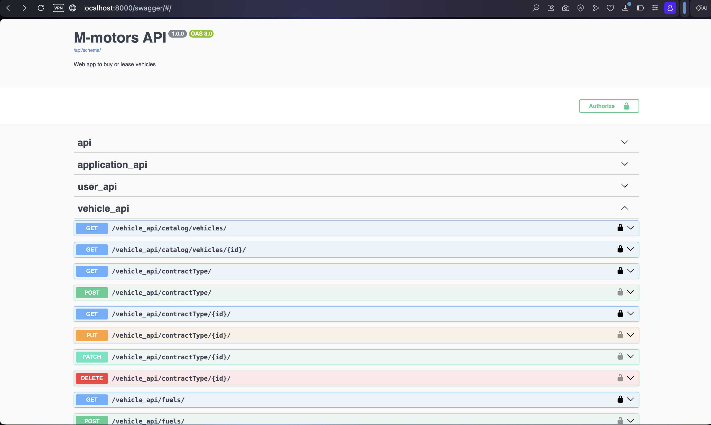

# 🚘 M-Motors — Vente et location de véhicules


**M-Motors** est une application web de consultation et de gestion d’un catalogue de véhicules proposés à la vente ou à la location. Les clients peuvent créer un compte, parcourir les véhicules disponibles et soumettre un dossier. Une interface d’administration permet de gérer le catalogue et d’examiner les dossiers déposés.

---

## 🚀 Fonctionnalités

- Consultation et recherche du catalogue de véhicules
- Filtres par marque, prix, kilométrage, année, carburant, boîte de vitesses et type de contrat
- Pages de détail avec galerie d’images et informations de location
- Création de compte et connexion avec authentification JWT
- Dépôt et suivi des dossiers avec pièces justificatives
- Espace administrateur pour gérer les véhicules et traiter les dossiers
- Documentation de l’API avec Swagger et ReDoc
- Stockage des images et documents avec Cloudinary
- Suivi des erreurs et des performances avec Sentry (front-end et back-end)

---

## 🛠️ Technologies utilisées

- **Front-end :** React 19, Vite 8, Tailwind CSS 4, Axios, React Router
- **Back-end :** Python 3.11, Django 5.2, Django REST Framework
- **Base de données :** PostgreSQL 16
- **Stockage des médias :** Cloudinary
- **Monitoring :** Sentry
- **Conteneurs :** Docker Compose, Nginx, Gunicorn

---

## 📦 Prérequis

- Docker et Docker Compose
- Un compte Cloudinary avec les identifiants API (nécessaire pour l’envoi d’images et de documents)
- Git

Pour un lancement sans Docker, il faut également Python 3.11+, Node.js 20+ et PostgreSQL 16.

---

## 💻 Lancer le projet avec Docker

1. **Cloner le dépôt et ouvrir le dossier :**

   ```bash
   git clone <URL_DU_DEPOT>
   cd M-Motors_project
   ```

2. **Créer le fichier `.env` à la racine du projet :**

   Ajoutez-y les valeurs ci-dessous (choisissez vos propres mots de passe et clé secrète) :

   ```dotenv
   # Django
   SECRET_KEY=remplacez_par_une_cle_secrete_longue_et_aleatoire
   DEBUG=True

   # PostgreSQL
   POSTGRES_DB=m_motors
   POSTGRES_USER=m_motors
   POSTGRES_PASSWORD=changez_ce_mot_de_passe
   POSTGRES_PORT=5432
   DATABASE_URL=postgresql://m_motors:changez_ce_mot_de_passe@db:5432/m_motors

   # Cloudinary
   CLOUD_NAME=votre_cloud_name
   API_KEY=votre_api_key
   API_SECRET=votre_api_secret

   # Sentry pour le back-end Django
   SENTRY_DSN=https://votre_cle@o000000.ingest.sentry.io/0000000
   ```

   Les variables Cloudinary et `SENTRY_DSN` sont chargées par Django au démarrage. Gardez `.env` privé et ne le commitez pas.

   Pour activer Sentry dans le front-end Vite, créez `frontend/.env` avec le DSN du projet Sentry destiné au navigateur :

   ```dotenv
   VITE_SENTRY_DSN=https://votre_cle@o000000.ingest.sentry.io/0000000
   ```

   Le front-end n’initialise Sentry que si `VITE_SENTRY_DSN` est défini. Utilisez le DSN Browser fourni par Sentry et gardez les DSN réels hors du dépôt.

3. **Démarrer les services :**

   ```bash
   docker compose up --build -d db backend frontend-dev
   ```

   Cette commande démarre PostgreSQL, l’API Django et le front-end Vite.

4. **Ouvrir l’application :**

   - Développement Vite : [http://localhost:5173](http://localhost:5173)
   - API Django : [http://localhost:8000](http://localhost:8000)
   - Administration Django : [http://localhost:8000/admin/](http://localhost:8000/admin/)
   - Documentation Swagger : [http://localhost:8000/swagger/](http://localhost:8000/swagger/)
   - Documentation ReDoc : [http://localhost:8000/redoc/](http://localhost:8000/redoc/)
   - Health check : [http://localhost:8000/health/](http://localhost:8000/health/)

   Les migrations et la collecte des fichiers statiques sont lancées par le conteneur backend. Pour créer un compte administrateur Django :

   ```bash
   docker compose exec backend python manage.py createsuperuser
   ```

5. **Arrêter les services :**

   ```bash
   docker compose down
   ```

   Pour supprimer également les données PostgreSQL persistées, utilisez `docker compose down -v`.

### Commandes utiles

```bash
# Voir les logs
docker compose logs -f

# Exécuter les migrations manuellement
docker compose exec backend python manage.py migrate
```

---

## 🔌 Principales routes de l’API

- `POST /api/token/` et `POST /api/token/refresh/` : obtenir et renouveler un jeton JWT
- `/user_api/users/` : comptes utilisateurs et inscription
- `/vehicle_api/catalog/vehicles/` : catalogue public des véhicules disponibles
- `/vehicle_api/vehicles/` : gestion des véhicules
- `/application_api/application/` : dépôt et suivi des dossiers
- `GET /health/` : état de santé de l’API et de sa connexion à la base de données

---

## 𖦥 Stratégie de branches Git

La gestion du versionnement s’appuie sur une stratégie de nommage et d’isolation des branches afin de garantir la stabilité du code mis en production :

- **`main` (production)** : branche principale contenant du code stable et testé, reliée à l’environnement de déploiement sur Render.
- **`development` (intégration)** : branche centrale regroupant les fonctionnalités finalisées et validées avant leur mise en production.

### Types de branches de développement

- **`feature/*` (fonctionnalités)** : branches éphémères créées depuis `development` pour développer une User Story ou une nouvelle fonctionnalité. Exemples : `feature/login`, `feature/vehicle-crud`.
- **`bugfix/*` (corrections de bugs)** : branches utilisées pour corriger un bug détecté pendant les tests sur `development`. Exemple : `bugfix/recaptcha`.
- **`hotfix/*` (correctifs urgents)** : branches créées depuis `main` pour corriger un incident critique en production, puis fusionnées dans `main` et `development`. Exemple : `hotfix/security-jwt`.
- **`release/*` (versions)** : branches préparatoires qui permettent de stabiliser une version avant son passage en production sur `main`. Exemple : `release/deploy-prod`.

Après les tests globaux et la validation sur `development`, les modifications sont fusionnées dans `main` pour la mise en production.

---

## 📘 Documentation de l’API avec Swagger

Le projet expose une documentation interactive générée à partir du schéma OpenAPI 3.0. Swagger regroupe les endpoints par API (notamment `api`, `application_api`, `user_api` et `vehicle_api`), présente les méthodes HTTP disponibles et permet de consulter les paramètres et les réponses attendues. Les routes protégées peuvent être testées après authentification avec le bouton **Authorize**.

- En local : [http://localhost:8000/swagger/](http://localhost:8000/swagger/)
- En production : [documentation Swagger sur Render](https://m-motors-9ufv.onrender.com/swagger/)

La capture ci-dessous montre l’interface Swagger et plusieurs endpoints de `vehicle_api` :



---

## 🌐 Déploiement

Le site et son API sont déployés sur **Render** :

- Site web : [https://m-motors-frontend-ohqq.onrender.com](https://m-motors-frontend-ohqq.onrender.com)
- Documentation : [https://m-motors-9ufv.onrender.com/swagger/](https://m-motors-9ufv.onrender.com/swagger/)

### Monitoring Sentry

Sentry est configuré séparément pour le front-end et le back-end :

- Le back-end Django lit `SENTRY_DSN` depuis son environnement.
- Le front-end React/Vite lit `VITE_SENTRY_DSN` au moment de la construction ou du démarrage de Vite.

### Monitoring de disponibilité avec Better Stack Uptime

L’endpoint `GET /health/` est destiné à être interrogé régulièrement par un service de monitoring externe, comme Better Stack Uptime. Il vérifie que Django peut exécuter une requête simple (`SELECT 1`) sur la base de données :


---

## 👤 Auteur

    Développé dans le cadre du projet M-Motors.
    Auteur : Juan Gil
    Contact : gilj06@hotmail.com
